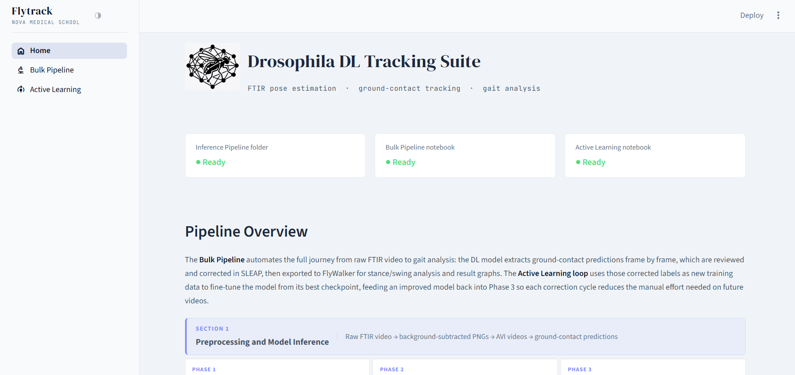

# DL Locomotion Tracking



Deep learning pose estimation for *Drosophila melanogaster* ground-contact leg
tracking from FTIR high-speed video, replacing the auto-detection step in the
MATLAB **FlyWalker** gait analysis software.

MSc thesis project (Mechanical Engineering, Design of Mechatronic Systems,
IST Lisboa), supervised by Prof. Dr. Rui Moura Coelho (IST) and Prof. Dr.
César Mendes (NOVA Medical School).

## Background

FTIR (frustrated total internal reflection) illumination makes a fly's legs
visible only while they are physically touching the glass surface underneath
it; legs in the air are invisible in the footage. The model's job is
therefore not to track all six legs at all times, but to detect **which**
legs are currently in contact with the ground and **where**. A missing
keypoint prediction is a real airborne leg, not a labelling gap.

## Pipeline

```
raw video → background subtraction → DL model inference → SLEAP correction → FlyWalker analysis
```

1. **Preprocessing** — background-subtracted, hot-colourmap `.avi` video (250 FPS)
2. **Inference** — a trained pose model predicts (x, y) ground-contact positions per frame, for whichever legs are touching
3. **Correction** — predictions are loaded into [SLEAP](https://sleap.ai/) for visual inspection and manual correction
4. **Export** — corrected labels are converted into a `TRACKS.mat` file and analysed by the existing FlyWalker MATLAB scripts

Two model families are implemented:

- **SLEAP-NN** (primary) — single-instance pose models (UNet, ConvNeXt, SwinT
  backbones, with/without ImageNet pretraining) trained via
  [`sleap-nn`](https://github.com/talmolab/sleap-nn)
- **ADPT** (secondary, thesis reference) — a custom ResNet-50 + Transformer
  architecture based on Tang et al., *eLife* 2025, implemented in PyTorch

The best-performing model to date is a pretrained ConvNeXt-tiny SLEAP-NN
model (test set mean position error ≈1.4 px on a 9-keypoint skeleton: head,
thorax, abdomen, and six leg tips).

## Repository layout

| Path | Contents |
|---|---|
| `gui/` | Streamlit app (Bulk Pipeline + Active Learning workflows) |
| `Inference_Pipeline/` | Dataset, trained models, inference/training notebooks |
| `SLEAP_Dataset_Utils/` | Standalone scripts for scaling/relinking `.slp` label files and embedding frames for Colab |

## Setup

### 1. Prerequisites

- [Anaconda or Miniconda](https://docs.conda.io/en/latest/miniconda.html), Python 3.11-3.13
- MATLAB (only invoked in Phase 10, to run the FlyWalker analysis)
- Optional: an NVIDIA GPU + CUDA driver ≥520 for local training/inference;
  the GUI and Colab-based training work fine without one

### 2. Clone the repository

```bash
git clone https://github.com/Vasquez-505/DL-Locomotion-Tracking.git
cd DL-Locomotion-Tracking
```

### 3. Create the environment

```bash
conda create -n flytrack python=3.11 -y
conda activate flytrack

# torch: pick ONE of the following
pip install torch==2.11.0+cpu torchvision==0.26.0+cpu --index-url https://download.pytorch.org/whl/cpu  # CPU-only
pip install torch==2.11.0 torchvision==0.26.0                                                            # CUDA GPU

pip install sleap-nn==0.3.1 sleap-io==0.9.2 sleap==1.6.2 h5py==3.16.0 pandas==3.0.2 \
    matplotlib==3.10.8 psutil==7.0.0 PyYAML==6.0.2 opencv-python==4.13.0.92 \
    scipy==1.17.1 streamlit==1.56.0 imageio[ffmpeg] pillow
```

The exact pins above match `Inference_Pipeline/Installation_requirements.txt`
(the checkpoints were trained against `sleap-nn==0.3.1` specifically; an
unpinned install can pull in a version whose config schema no longer matches
the saved checkpoints). `imageio` and `pillow` are additional runtime
dependencies of the video-overlay feature not yet captured in that file.

### 4. Launch the GUI

```bash
streamlit run gui/app.py
```

On Windows, double-click `launch_gui.bat` instead: it finds any conda
environment with Streamlit installed (checking `flytrack` first) and launches
the app automatically, no manual `conda activate` needed.

Model training and fine-tuning run on Google Colab (see the notebooks in
`Inference_Pipeline/`); local inference and the GUI run fine on CPU.

The GUI has two pages:

- **Bulk Pipeline** — runs preprocessing, inference, and FlyWalker export
  end-to-end for a batch of videos, plus an annotated-video overlay for
  visual QC of predictions
- **Active Learning** — merges corrected SLEAP labels back into the training
  set and fine-tunes a model from its best checkpoint (locally or via Colab)

## Status

Actively developed as part of an ongoing thesis. See commit history for
current progress; model checkpoints and evaluation metrics live under
`Inference_Pipeline/Models/SLEAP_Models/`.
